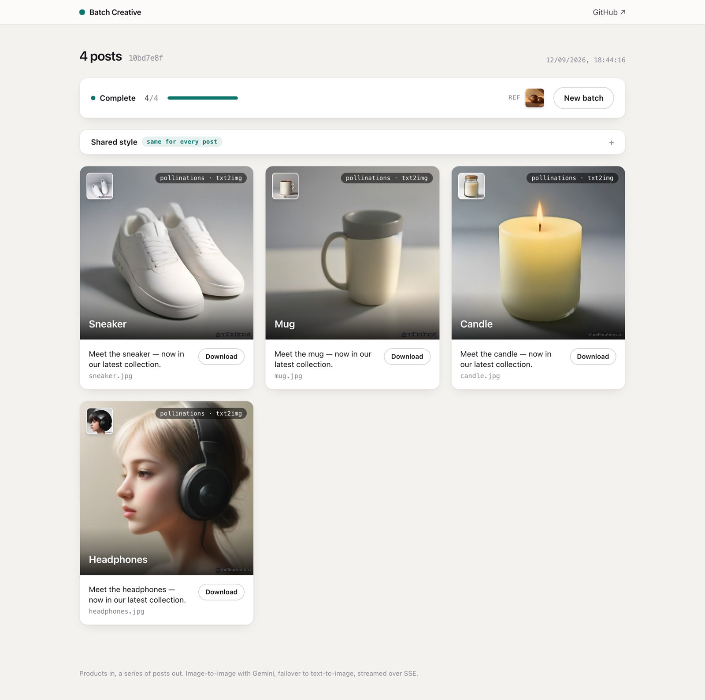
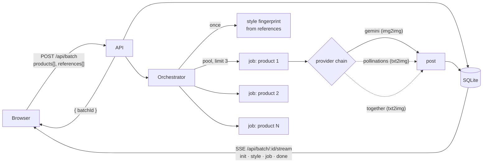
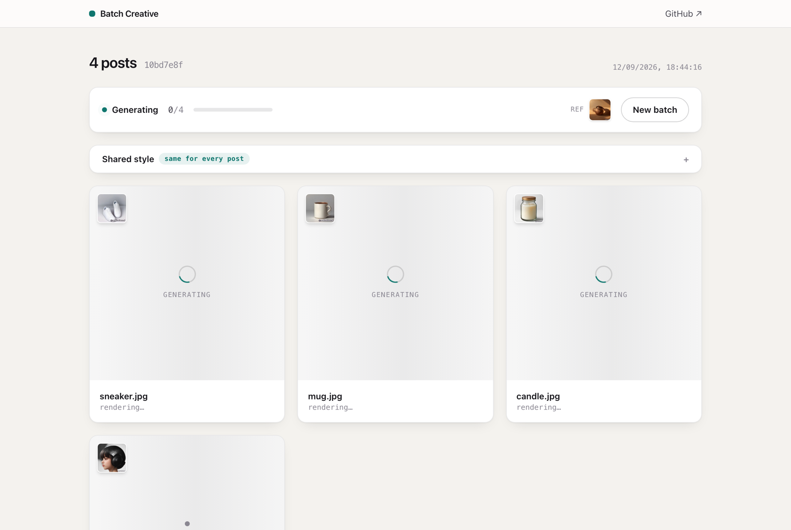

# Batch Creative

Turn a set of product photos and one reference image into a consistent series of
social posts. Each post is generated from the **actual product pixels** in the
**actual reference's style**, gets an AI-written headline and caption, and lands on
the page the moment it is ready.



<sub>Screenshots are from a keyless dry run (text-to-image), hence the `txt2img` badges. With `GEMINI_API_KEY` the same cards read `gemini · img2img` and the uploaded product is what gets rendered.</sub>

> Built as a take-home exercise, then reworked into a small production-shaped app:
> real image-to-image generation, persistence, failover, tests and a Docker deploy.

## What it does

- **Upload** 1–12 product images and 1–2 reference images (drag & drop).
- **One shared style.** The references are captioned once into a compact style
  description that is reused verbatim for every product, and the reference pixels
  themselves are sent along with each product to an image-to-image model.
- **Progressive delivery.** The request returns a batch id at once; the batch page
  subscribes over Server-Sent Events and each card flips pending → running → done
  (or failed) independently.
- **Reliability.** Per-provider retries with exponential backoff (transient errors
  only, with `Retry-After` honoured), failover across an ordered provider chain, a
  per-provider circuit breaker, and per-product isolation so one failure never sinks
  the batch.
- **Persistence.** Batches, uploads and results live in SQLite. Refreshing the page,
  sharing the batch URL or restarting the server does not lose anything.

## Quick start

```bash
cp .env.example .env      # add GEMINI_API_KEY (see below)
npm install
npm run dev               # http://localhost:3000
```

Node 22 or newer. Without any key the app still runs end to end on a keyless
text-to-image provider, but then the uploaded pixels do not influence the result
(the style is a fixed template and the subject comes from the product filename).
The UI says so. Treat keyless mode as a dry run of the pipeline, not as output.

### Environment

| Variable | Default | Effect |
|---|---|---|
| `GEMINI_API_KEY` | – | **The real thing.** Image-to-image generation with `gemini-3.1-flash-image`, plus reference captioning, product description and copy with `gemini-3.5-flash-lite`. Override with `GEMINI_IMAGE_MODEL` / `GEMINI_TEXT_MODEL`. |
| `OPENROUTER_API_KEY` | – | Alternative captioning/copy client when no Gemini key is set (`OPENROUTER_VISION_MODEL`). |
| `TOGETHER_API_KEY` | – | Adds Together AI FLUX as another text-to-image provider after Pollinations. |
| `ENABLE_MOCK_PROVIDER` | `false` | Appends an offline placeholder provider (demos, tests). Off by default so exhausted products are reported as failed, not faked. |
| `GEN_FORCE_FAIL` | – | Comma-separated product filenames the primary text provider refuses. Demo hook for partial failure + failover. |
| `MAX_CONCURRENCY` | `3` | Products generated at once. |
| `MAX_PRODUCTS` / `MAX_FILE_BYTES` | `12` / 10 MB | Upload limits. |
| `RATE_LIMIT_BATCHES` / `RATE_LIMIT_WINDOW_MS` | `10` / 10 min | Batches per client address per window. |
| `BATCH_TTL_MS` | 24 h | How long batches and their images are kept. |
| `DATABASE_PATH` | `./data/batch-creative.db` | SQLite file (`:memory:` under tests). |

## How it works





Per product: describe the product (vision) → build the prompt (shared fingerprint +
this product's description) → `generatePost` walks the provider chain → store the
image → emit a `job` event. Headline and caption are written concurrently with the
image so copy never adds latency.

**Provider chain** `gemini? → pollinations → together? → mock?`. Each provider gets
up to three tries with backoff; a 4xx fails over immediately, a 429 waits at least
three seconds or `Retry-After`. A provider that fails three products in a row is
skipped for a minute (circuit breaker). Each card shows which provider produced it
and whether it was image-conditioned (`img2img`) or text-only (`txt2img`).

**Consistency** comes from three things applied identically to every product in a
batch: the same reference pixels, the same style paragraph, and the same seed.

### API

| Method | Route | Notes |
|---|---|---|
| `POST` | `/api/batch` | `multipart/form-data` with `products` (1–12) and `references` (1–2). Returns `{ batchId, productCount }`. `400` on validation, `429` when rate limited. |
| `GET` | `/api/batch/:id` | JSON snapshot of the batch. |
| `GET` | `/api/batch/:id/stream` | SSE. `init` (full snapshot) → `style` → `job`* → `done`. Heartbeats every 15 s. |
| `GET` | `/api/images/:id` | Uploaded or generated image, immutable cache. |

## Development

```bash
npm run check    # typecheck + lint + tests
npm test         # vitest
npm run build && npm start
```

Tests cover the retry/backoff policy, the failover chain, the circuit breaker, the
concurrency pool, upload validation, the rate limiter, the SQLite store (including
restart recovery), the orchestrator's failure isolation and the SSE event ordering.
CI runs all of it plus a production build on every push.

Demonstrate failover locally:

```bash
GEN_FORCE_FAIL=mug.jpg ENABLE_MOCK_PROVIDER=true npm run dev
# mug.jpg fails fast on the text provider and falls over to the mock;
# its card shows "mock · txt2img · 2 tries" while the rest complete normally.
```

## Deploy

The app is one long-lived Node process (SSE streams, in-process job pool, SQLite
on disk), so it wants a container host with a volume rather than a serverless
platform.

```bash
docker build -t batch-creative .
docker run -p 3000:3000 -v batch-data:/data -e GEMINI_API_KEY=... batch-creative
```

`fly.toml` is included: `fly launch --no-deploy`, `fly volumes create data --size 1`,
`fly secrets set GEMINI_API_KEY=...`, `fly deploy`. Railway and Render pick up the
Dockerfile as is; mount a volume at `/data`.

## Design notes

- **Why image-to-image and not "describe then draw".** The first version captioned
  the reference to text and asked a text-to-image model for the product. That yields
  "similar by description", not "the same product in that style". Sending the pixels
  is the only way the uploads actually matter. The text path stays as failover and
  is labelled as such on every card.
- **Why SQLite via `node:sqlite`.** Batches need to survive a refresh and a restart,
  but this is a single-process app with a few thousand rows. Node's built-in SQLite
  needs no native addon, which keeps the Docker image trivial. On startup, jobs left
  running by a crash are marked failed so no card spins forever.
- **Why an in-process pool and not a queue.** The concurrency limit and fan-out are
  the whole requirement; a broker would be infrastructure for its own sake at this
  size. The orchestrator is isolated behind one function so a queue could replace it.
- **Why the mock provider is opt-in.** A placeholder that silently replaces a failed
  generation hides the failure. Off by default; on for demos and tests.
- **What is deliberately not here.** Auth and multi-tenancy, a job queue, image
  moderation, multi-region. Each is a known next step, not an oversight.

## Layout

```
src/
  app/
    page.tsx                  upload form + recent batches
    b/[id]/page.tsx           batch page (server-rendered snapshot + live SSE)
    api/batch/                POST create · GET snapshot · GET stream
    api/images/[id]/          image bytes
  components/                 UploadArea, UploadForm, BatchView, ResultCard, RecentBatches
  lib/
    orchestrator.ts           fingerprint once, fan out, isolate failures
    generation/               provider chain, retry policy, circuit breaker, providers/
    style/                    fingerprint, product description, copy, fallbacks
    vision/                   Gemini + OpenRouter LLM clients
    store.ts · db.ts          SQLite store, event emitters, TTL eviction, recovery
    pool.ts · ratelimit.ts · validation.ts
```
